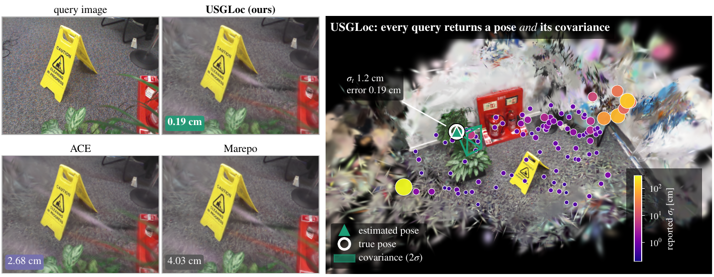
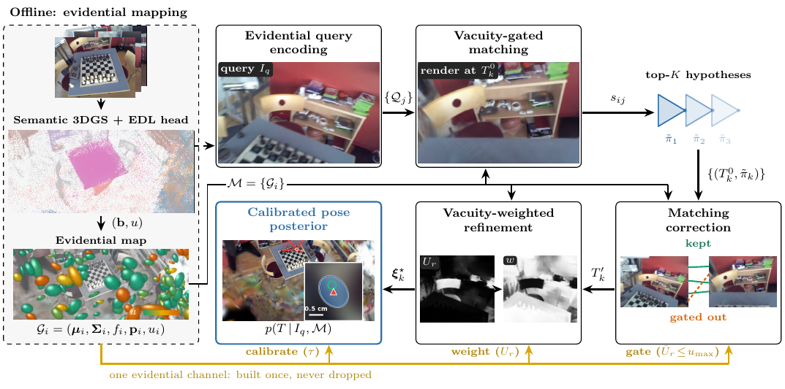

USGLoc: Uncertainty-Aware Semantic Visual Localization from 3D Gaussian Splatting
===

**IEEE Robotics and Automation Letters (under review)**

[Paper (coming soon)]() | [Video (coming soon)]()



USGLoc returns a camera pose **and** its covariance. Every 7Scenes test query is colored by the
uncertainty σ<sub>t</sub> it reports; a large σ<sub>t</sub> marks a query that is likely wrong.

## Overview

A localizer on a robot feeds a Bayesian state estimator, so it should say how far to trust each
pose. USGLoc is a prior-free localizer on a semantic 3D Gaussian Splatting map that outputs a
Gaussian mixture over SE(3) instead of a point:

- **Evidential map.** Each map primitive carries a Dempster–Shafer belief over open-vocabulary
  semantics with an explicit vacuity (missing-evidence) mass. The query is encoded by the same head.
- **One uncertainty channel, end to end.** The vacuity gates 2D–3D semantic matching and the
  correspondences of a render-and-match correction, and, rendered like color, weights the
  photometric refinement per pixel.
- **Pose distribution.** A tempered Laplace approximation at each refined hypothesis gives a
  covariance; the mixture condenses to one Gaussian for an EKF/UKF.



## Table of Contents

1. [Installation](#installation)
2. [Data](#data)
3. [Run](#run)
4. [Evaluation](#evaluation)
5. [Synthetic demo](#synthetic-demo)
6. [Code structure](#code-structure)
7. [Acknowledgement](#acknowledgement)
8. [Citation](#citation)
9. [Contact](#contact)

## Installation

Tested on Ubuntu 22.04, Python 3.12, PyTorch 2.11 + CUDA 12.8 and gsplat 1.5.3, on a 12 GB GPU.

1. Clone the repository.
   ```bash
   git clone https://github.com/pairs-lab/usgloc.git && cd usgloc
   ```
2. Create an environment and install PyTorch for your CUDA version.
   ```bash
   python3 -m venv ~/venvs/usgloc && source ~/venvs/usgloc/bin/activate
   pip install torch torchvision --index-url https://download.pytorch.org/whl/cu128
   ```
3. Install USGLoc with the renderer and the real-data front end (FastSAM + CLIP).
   ```bash
   export CUDA_HOME=/usr/local/cuda-12.8      # gsplat compiles its kernels against it
   pip install -e ".[render,realdata,dev]"
   ```
4. Third-party matchers and weights.
   - **MASt3R** is used as a source tree. Clone [naver/mast3r](https://github.com/naver/mast3r)
     with its `dust3r`/`croco` submodules, download the
     `MASt3R_ViTLarge_BaseDecoder_512_catmlpdpt_metric` checkpoint, and point to both:
     ```bash
     export MAST3R_ROOT=/path/to/dir/containing/mast3r
     export MAST3R_CKPT=/path/to/mast3r_ckpt
     ```
   - **FastSAM-s** weights (`FastSAM-s.pt`) in the repository root.
   - **SuperPoint** weights (`superpoint_v1.pth`) in `usgloc/weights/`.
   - LoFTR (kornia) and CLIP ViT-B/16 (open_clip) download their weights on first use.
5. Check the install.
   ```bash
   python3 -m pytest tests -q
   ```

## Data

```bash
bash scripts/download_7scenes.sh      # -> data/7scenes_source/
bash scripts/download_12scenes.sh     # -> data/12scenes_source/
git clone https://github.com/tsattler/visloc_pseudo_gt_limitations data/visloc_pseudo_gt_limitations
```

All results use the **SfM pseudo-ground truth** and its focal lengths
(`data/visloc_pseudo_gt_limitations/pgt/sfm/{7scenes,12scenes}`), the convention of recent
3DGS localizers. Maps, checkpoints and results go to `maps/`, `ckpts/` and `results/`, which are
not versioned.

## Run

One scene end to end, here 7Scenes *chess*. For 12Scenes, use `ROOT=data/12scenes_source`,
`DS=12scenes` and a scene such as `SC=apt1/kitchen` (output names replace `/` by `_`).

```bash
ROOT=data/7scenes_source; DS=7scenes; SC=chess
PGT=data/visloc_pseudo_gt_limitations/pgt/sfm/$DS
DEPTH="--depth-weight 0.2 --depth-scale 1.0"

# 1. Semantic 3DGS map at 320x240 (the first map also trains an initial head, ckpts/edl_head.pt).
#    A 640x480 variant: --fit-width 640 --fit-height 480 --iters 20000 --fit-stride 5 --views-uint8
python scripts/train_map.py --root $ROOT --dataset $DS --scene $SC --sfm-pose-dir $PGT \
    --out maps/$SC.pt --psnr-frames 20 $DEPTH

# 2. Evidential head shared by all scenes of a benchmark, re-applied to every map
python scripts/train_head.py --root $ROOT --dataset $DS --sfm-pose-dir $PGT --scenes $SC \
    --maps-dir maps --out ckpts/head.pt
python scripts/reapply_head.py --head ckpts/head.pt --maps maps/$SC.pt
#    optional: pick the fit resolution per scene on train-side frames
python scripts/analysis/select_map.py --dataset $DS --maps maps

# 3. Fine-tune the map at 640x480 (densification off)
python scripts/finetune_map.py --root $ROOT --dataset $DS --scene $SC --sfm-pose-dir $PGT \
    --map maps/$SC.pt --out maps/${SC}_r1.pt --psnr-frames 20 $DEPTH

# 4. Per-Gaussian descriptor field (SuperPoint-distilled, PCA to 64-d).
#    Add --cpu-opt-state for maps above ~1M Gaussians on a 12 GB GPU.
python scripts/analysis/train_locfeat.py --root $ROOT --dataset $DS --scene $SC --sfm-pose-dir $PGT \
    --map maps/${SC}_r1.pt --out maps/${SC}_r1_lf64.pt --pca-dim 64 --feats-only

# 5. Retrieval encoders
python scripts/train_encoders.py --root $ROOT --dataset $DS --scene $SC --sfm-pose-dir $PGT \
    --map maps/${SC}_r1.pt --head-ckpt ckpts/head.pt --out ckpts/${SC}_encoders.pt

# 6. Localize 100 test queries (MASt3R -> descriptor-field correction, the paper's configuration)
python scripts/run_7scenes.py --root $ROOT --dataset $DS --scene $SC --sfm-pose-dir $PGT \
    --map maps/${SC}_r1.pt --corr-feats maps/${SC}_r1_lf64.pt --encoders ckpts/${SC}_encoders.pt \
    --queries 100 --device cuda --top-k 3 --iters 60 --temperature-split 0.5 --temp-calib-frames 30 \
    --anchor-stride 20 --submap-radius 3.0 --renderer gsplat --width 640 --height 480 \
    --fuse-rule yager --lambda-u 2.0 --shortlist 10 --opinion-mode edl --corr-refine-iters 60 \
    --correction --support-power 1.0 --corr-conf-min 0.2 --gamma 3.0 --seed 0 --oom-retries 40 \
    --corr-rounds 8 --corr-matcher stage --corr-stage-warm mast3r --corr-feat-stage 3 \
    --corr-stop-dt 0.0002 --corr-stop-dr 0.01 --out results/${DS}_seed0
```

The covariance temperature is fitted on 30 train-side frames, never on test queries.

## Evaluation

`run_7scenes.py` writes one JSON per scene with the estimated pose, covariance and errors of every
query, and prints median errors, success rates, coverage, AUSE and ECE.

```bash
python scripts/make_tables.py results/7scenes_seed0 [results/7scenes_seed1 ...]   # median over seeds
python scripts/analysis/fill_table2_12scenes.py --run results/12scenes_seed0         # 12Scenes row
```

**PoseNet baseline.** No released PoseNet model exists for 12Scenes or the SfM pseudo-GT, so we
retrain it per scene (MapNet's PoseNet recipe: ResNet34, 300 epochs) and test it on the same queries:

```bash
python scripts/analysis/train_posenet.py --dataset 12scenes --scene apt1/kitchen
```

## Synthetic demo

A self-contained check that needs no dataset: a room of splat objects, 25% of which move after
mapping, localized with the full method and its ablations.

```bash
python3 scripts/run_demo_synthetic.py --queries 16
```

It prints accuracy and calibration (coverage at 68.3/95.4/99.7%, ECE, AUSE, NLL) for `full` and
`full+temp` (raw and tempered), `no-weight` (γ = 0), `fixed-cov` (one shared covariance),
`top1-point` (K = 1) and `icomma` (photometric refinement only).

## Code structure

| Module | Paper | Contents |
|---|---|---|
| `usgloc/evidential.py` | III-A | EDL evidence → (belief, vacuity), Dempster and Yager fusion, EDL loss, shared head |
| `usgloc/primitives.py` | III-A | Evidential primitives (μ, Σ, f, p, u), per-object DST fusion, submaps |
| `usgloc/query.py` | III-B | Query front end: FastSAM masks + CLIP + the shared evidential head |
| `usgloc/descriptors.py` | III-C | Instance and scene descriptors, attention aggregation with the evidential gate, InfoNCE |
| `usgloc/matching.py` | III-C | Vacuity-gated 2D–3D similarity, retrieval → weighted pose hypotheses |
| `usgloc/correction.py` | III-D | Render-and-match correction (LoFTR, MASt3R, descriptor field), vacuity-gated PnP |
| `usgloc/locfeat.py` | III-D | Per-Gaussian descriptor field: initialization, fine-tuning, matching |
| `usgloc/rendering.py` | III-E | Splatting with the vacuity channel alpha-blended like color (torch and gsplat) |
| `usgloc/refinement.py` | III-E | Vacuity-weighted pose refinement, Laplace covariance |
| `usgloc/posterior.py` | III-E | SE(3) Gaussian mixture, NLL, moment-matched condensation |
| `usgloc/calibration.py` | III-E, IV | Covariance temperature fitting and calibration reports |
| `usgloc/metrics.py` | IV | Median errors, success rates, coverage vs. χ², AUSE, ECE |
| `usgloc/pipeline.py` | Alg. 1 | End-to-end `localize(image, instances) → posterior` |
| `usgloc/datasets.py` | IV | 7Scenes / 12Scenes loaders and the map bridge format |
| `usgloc/baselines.py` | IV | In-framework baselines (iComMa-style, top-1 point, fixed covariance) |
| `usgloc/synthetic.py` | — | Semi-dynamic synthetic rooms for the demo and tests |

Implementation notes:

- **Dempster's rule hides conflict.** Two confident, contradictory opinions fuse to a low-vacuity
  compromise, so moved objects are not flagged. Use `fuse_rule="yager"` (routes conflict into
  vacuity, the paper's setting) or `effective_vacuity = min(1, u + eta)`.
- The per-pixel weights are **detached** during refinement (IRLS-style); differentiating through
  them would reward moving into high-vacuity regions.
- The Laplace covariance is σ̂²(JᵀWJ)⁻¹ with σ̂² estimated from the residuals, so degraded queries
  get larger covariances.

## Acknowledgement

This work builds on [gsplat](https://github.com/nerfstudio-project/gsplat),
[MASt3R](https://github.com/naver/mast3r), [LoFTR](https://github.com/zju3dv/LoFTR) (via
[kornia](https://github.com/kornia/kornia)),
[SuperPoint](https://github.com/magicleap/SuperPointPretrainedNetwork),
[FastSAM](https://github.com/CASIA-LMC-Lab/FastSAM), [OpenCLIP](https://github.com/mlfoundations/open_clip),
the descriptor field of [STDLoc](https://github.com/zju3dv/STDLoc), the retrieval design of SGLoc,
and the pseudo-ground truth of [Brachmann et al.](https://github.com/tsattler/visloc_pseudo_gt_limitations)
We thank the authors for releasing their code.

## Citation

```bibtex
@article{usgloc2026,
  title   = {{USGLoc}: Uncertainty-Aware Semantic Visual Localization from {3D} Gaussian Splatting},
  author  = {},
  journal = {IEEE Robotics and Automation Letters},
  year    = {2026},
  note    = {under review}
}
```

## Contact

For questions or bug reports, please open an issue.
